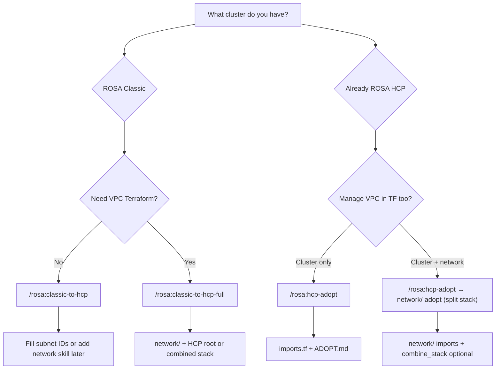

# ROSA Terraform guide

This plugin generates Terraform for **ROSA HCP** using the supported registry module [`terraform-redhat/rosa-hcp/rhcs`](https://registry.terraform.io/modules/terraform-redhat/rosa-hcp/rhcs/latest) ([source](https://github.com/terraform-redhat/terraform-rhcs-rosa-hcp)). It does **not** invent alternate module layouts or hand-written import IDs.

## How you run it

**In Cursor / Claude Code:** use slash commands. The **agent** runs `rosa`, discovery scripts, generators, and `terraform fmt` / `validate` / `plan`. You confirm choices at dry-run gates; you run `terraform apply` when ready (the agent does not apply unless you ask).

| You type | When |
|----------|------|
| `/rosa:classic-to-hcp <classic> [dir]` | Map a **Classic** cluster to a **new** HCP stack (cluster module only) |
| `/rosa:classic-to-hcp-full <classic> [dir]` | Network discover + **adopt** or **copy** VPC + HCP stack + merged wiring |
| `/rosa:hcp-adopt <hcp> [dir]` | Import an **existing HCP** cluster (and optionally its VPC) into Terraform |

Optional second argument is the output directory (default under `./` or `tmp/` locally). **Committed samples:** [../../examples/rosa/](../../examples/rosa/) (anonymized generator output — see [examples/README.md](../../examples/README.md)).

Implementation details for agents: `commands/classic-to-hcp.md`, `commands/classic-to-hcp-full.md`, `commands/hcp-adopt.md`, and the skills listed below.

**Upstream module matrix:** [references/rosa-hcp-module-adopt-mapping.md](references/rosa-hcp-module-adopt-mapping.md) — `modules/vpc`, `shared-vpc-resources`, `additional-cp-sg`, OCM/`rosa` signals, and what MOBB adopt generates today vs roadmap. Clone `references/terraform-rhcs-rosa-hcp` locally (gitignored) to inspect source.

## Choose a path



| Situation | Command | Creates cluster in AWS? |
|-----------|---------|-------------------------|
| Duplicate Classic → new HCP | `classic-to-hcp` / `classic-to-hcp-full` | **Yes** on apply (greenfield module) |
| Terraform-manage live HCP | `hcp-adopt` | **No** — import blocks bind existing OCM/AWS objects |

**Do not** use `hcp-adopt` on Classic clusters or `classic-to-hcp` on clusters where `hypershift.enabled` is already true.

## Example output (anonymized)

| Example directory | Created by |
|-------------------|------------|
| [examples/rosa/hcp-adopt-split-stack/](../../examples/rosa/hcp-adopt-split-stack/) | `/rosa:hcp-adopt` — `rosa-hcp-adopt-terraform` + `network_to_tf.py` (adopt) |
| [examples/rosa/classic-to-hcp-full-combined/](../../examples/rosa/classic-to-hcp-full-combined/) | `/rosa:classic-to-hcp-full` — `classic_to_hcp.py` + `network_to_tf.py` (copy) + `combine_stack.py` |

Each tree includes **`EXAMPLE.md`** (provenance) and generator **`README.md`** / **`Makefile`**. Refresh from your own run with `plugins/rosa/scripts/publish_example_stack.py`.

## Prerequisites

| Requirement | Used for |
|-------------|----------|
| `rosa login` (see **rosa-cli** skill) | Cluster, pool, ingress, IdP JSON |
| AWS credentials (read-only for discovery) | VPC, subnets, TGW, endpoints, SGs |
| `RHCS_TOKEN` in environment | `terraform plan` / `apply` against OCM |
| Terraform ≥ 1.5.7 | Import blocks, module version |

Never commit tokens or generated admin passwords. Default dev tfvars may use placeholder admin credentials for validate/plan only — change before production apply.

## Skills and scripts

| Skill | Role |
|-------|------|
| **rosa-cli** | Auth, describe/list commands |
| **rosa-classic-to-hcp-terraform** | `classic_to_hcp.py`, `fetch_classic_idps.py`, `idp_terraform.py` |
| **rosa-classic-network-terraform** | `discover_cluster_network.py`, `network_to_tf.py`, `merge_hcp_stack.py`, `combine_stack.py`, `summarize_classic_inventory.py` |
| **rosa-hcp-adopt-terraform** | `hcp_adopt_to_tf.py` for existing HCP + `imports.tf` |

All Terraform skills are **agent-only** (`user_invocable: false` in frontmatter). Operators use commands; agents load skills automatically.

## Classic → HCP (greenfield stack)

### `/rosa:classic-to-hcp`

1. Collect Classic cluster, machine pools, ingress, hosted-cp versions, optional IdP inventory.
2. **`classic_to_hcp.py --dry-run`** — mapping preview, OpenShift version choice, infra pools, CIDR strategy.
3. **Stop** until you confirm target name, version, private/public, infra, CIDR reuse vs unique ranges, IdPs.
4. **`--write`** → `main.tf`, `terraform.tfvars`, `MIGRATION.md`, optional IdP files.
5. `terraform fmt` + `validate`.

Subnet IDs and VPC CIDR are **not** magic: either edit tfvars manually or use the network skill / full command.

**OpenShift version:** dry-run compares Classic to hosted-cp catalog. Same minor → nearest patch; if newer **minor** lines exist, you must pick explicitly (`--openshift-version` on write).

**Identity providers:**

- **htpasswd** — usernames copied; new passwords via `random_password` (Classic hashes not available from OCM).
- **OAuth/OIDC/GitHub/GitLab/Google/LDAP** — commented stubs; you register new client secrets and redirect URIs on the HCP apps domain, then uncomment.

### `/rosa:classic-to-hcp-full`

Everything in **classic-to-hcp**, plus:

1. **`discover_cluster_network.py`** → `network-inventory.json`.
2. **`summarize_classic_inventory.py`** — network + IdP briefing in chat.
3. You choose **network mode**:
   - **adopt** — import existing VPC/subnets (`imports.tf` under `network/`).
   - **copy** — new VPC CIDR while Classic is still up (no subnet reuse on live Classic).
4. **`network_to_tf.py --write`** → `network/`.
5. **`classic_to_hcp.py --write`** at stack root.
6. **`merge_hcp_stack.py`** (split dirs) or **`combine_stack.py`** (single root for copy stacks).
7. `MIGRATION-FULL.md` with IdP section when applicable.

**Adopt + live Classic:** HCP cannot safely reuse Classic subnet IDs until Classic is gone; full workflow usually pairs **copy** network with **unique** cluster CIDRs, or adopt network documentation only.

**Shared Transit Gateway / hub routes:** discovery may emit commented **`transit_gateway_optional.tf`** — coordinate with the network team; not auto-imported.

**Shared VPC:** out of scope for MOBB network generation.

**VPC endpoints:** if inventory lists **customer** (`adoptable`) endpoints, the agent **asks** before **`network_to_tf.py --write`**; use **`--skip-endpoints`** when declined. **Never** adopt the **ROSA HCP control-plane VPCE** in `network/`. **Private HCP:** additional control-plane SGs belong on the **cluster** module (`additional-cp-sg`), not as a adopted VPCE in `network/`. Optional scope: skip TGW / SGs / flow logs when requested.

## HCP adopt (import existing cluster)

### `/rosa:hcp-adopt`

For clusters already on **ROSA HCP** (e.g. `demo-hcp-public` in fixtures/examples).

1. Collect HCP cluster, **node pools** (`rosa list machinepools`), ingress JSON.
2. **`discover_cluster_network.py`** — subnet wiring for dry-run; VPC summary for the scope question.
3. **`hcp_adopt_to_tf.py --dry-run`** → present summary.
4. **Ask explicitly:** **cluster only** or **cluster + network**? Wait for an answer before any **`--write`**.
5. **`hcp_adopt_to_tf.py --write`** → `imports.tf`, tfvars, `ADOPT.md` (`create_* = false`).
6. If **cluster + network:** **`network_to_tf.py --mode adopt --write`** → `[dir]/network/` (split stack; not `combine_stack.py`).
7. `terraform fmt`, `validate`, **`plan`** on each root you generated (or **`make plan`** when a generated **`Makefile`** is present).

**Imports (typical):**

- `rhcs_cluster_rosa_hcp`
- `rhcs_hcp_default_ingress` (requires `wait_for_create_complete = true` in module so the resource exists in graph)
- Each **node pool** — import id `{cluster_id},{pool_name}`

**Autoscaling:** HCP worker scaling is **node pool autoscaling** (`machine_pools` in tfvars). When pools autoscale, adopt sets **`cluster_autoscaler_enabled = false`**. OCM exposes a cluster `/autoscaler` API object, but it is not the same as Classic-style cluster autoscaler; the generator does not enable the module’s `rhcs_hcp_cluster_autoscaler` for pool-autoscaled clusters.

**Properties:** tfvars include operator keys such as `rosa_creator_arn`. Keys **`rosa_tf_version`** / **`rosa_tf_commit`** are provider-reserved and omitted (OCM keeps them).

**Cluster + network adopt:** after cluster write, **`network_to_tf.py --mode adopt`** into `[dir]/network/` (**split stack** — separate `terraform apply` from cluster root). Do **not** use **`combine_stack.py`** (greenfield IAM + copy VPC only). Optional **`transit_gateway_optional.tf`** when discovery finds TGW attachments.

**Not in v1:** IdPs, image mirrors, log forwarders on adopt — add module variables manually after import.

## Generated artifacts (by path)

| Artifact | classic-to-hcp | classic-to-hcp-full | hcp-adopt |
|----------|----------------|---------------------|-----------|
| `terraform.tfvars` | ✓ | ✓ | ✓ |
| `imports.tf` | — | network adopt | cluster + ingress + pools |
| `MIGRATION.md` / `MIGRATION-FULL.md` | ✓ / ✓ | ✓ | `ADOPT.md` (→ README) |
| `README.md` | ✓ | ✓ | ✓ |
| `Makefile` | when generated | split or combined | split stack |
| `network/` | optional | ✓ | optional |
| IdP optional / htpasswd tf | ✓ | ✓ | — |
| `transit_gateway_optional.tf` | — | if discovered | if discovered |

## Plan and apply expectations

**Greenfield (Classic → HCP):** first plan shows **creates** for module-managed IAM/OIDC/operator roles (unless you pre-create and disable flags), cluster, pools, ingress. Review admin credentials and CIDRs before apply.

**Adopt (HCP):** first plan shows **imports** plus often:

- `null_resource.validations` (module one-shot)
- Read-only attribute refresh on cluster (URLs, state)
- Pool tags/version alignment after import refresh

Review **in-place** changes carefully; harmless noise is common, but metadata token or property drift should match live JSON before apply.

## Out of scope

- Importing Classic **IAM** into HCP roles as Terraform resources (reference by ARN/id only on adopt).
- Running **`terraform apply`** or **`destroy`** by default in agent workflows.
- **Terraformer** (deprecated); optional Former2/aws2tf noted in network **SPIKE.md** only.
- Non-AWS ROSA (plugin Terraform paths are AWS + `rhcs` provider).

## Contributors: tests

From repo root, per skill:

```bash
bash plugins/rosa/skills/rosa-classic-to-hcp-terraform/scripts/run_fixture_tests.sh
bash plugins/rosa/skills/rosa-classic-network-terraform/scripts/run_network_fixture_tests.sh
bash plugins/rosa/skills/rosa-hcp-adopt-terraform/scripts/run_fixture_tests.sh
```

Golden fixtures under each skill’s `fixtures/golden/`; run `make lint` before commit. Bump `plugins/rosa/.claude-plugin/plugin.json` version when changing commands or skills.

## Related commands (non-Terraform)

Cost and migration advisory commands (`/rosa:cost*`) share the plugin but do not invoke these Terraform skills. See [README.md](README.md).
